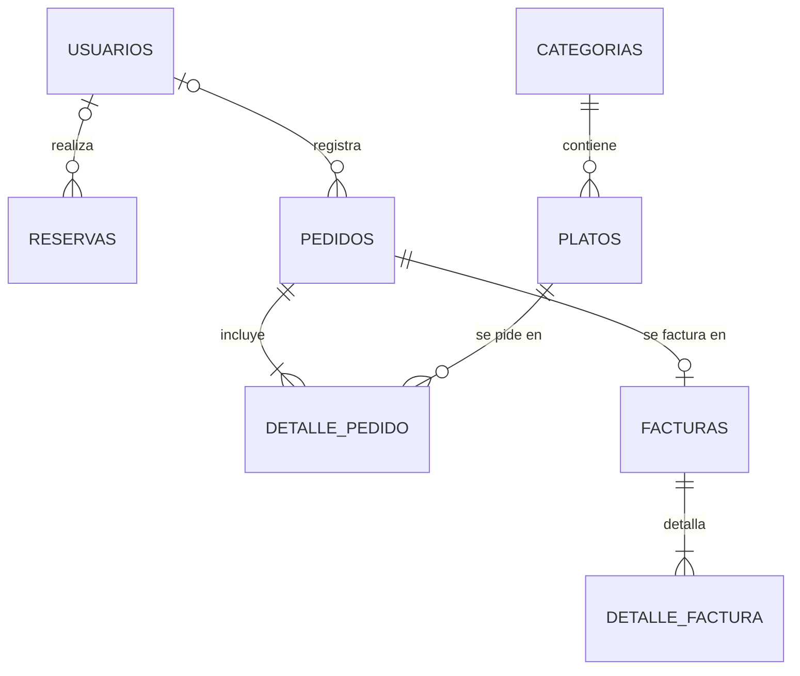

# Estructura de la base de datos

## Estado actual

En la línea base `v1.0.0` el sistema **todavía no usa una base de datos**. Los módulos `menu`, `pedidos`, `reservas` y `facturacion` guardan sus registros en arreglos en memoria, que se pierden al terminar la ejecución. El módulo `usuarios` no guarda registros: valida el inicio de sesión contra credenciales fijas de ejemplo escritas en el código.

Datos que maneja hoy cada módulo:

| Módulo | Datos en el código actual |
|---|---|
| `usuarios` | `login(username, password)`: sin registros, solo compara con credenciales fijas |
| `menu` | `{ nombre, precio }` |
| `pedidos` | `{ id, mesa, platos, estado }` (el estado inicial es `Pendiente`) |
| `reservas` | `{ id, nombreCliente, fecha, hora, personas }` |
| `facturacion` | `{ id, nombreCliente, items, subtotal, impuesto, total }` |

## Modelo relacional propuesto

Este es el modelo para la siguiente fase, cuando los módulos se conecten a un motor de base de datos (por ejemplo, PostgreSQL, MySQL o SQLite). Cada tabla conserva los campos que ya existen en el código (columna *Origen* = `código`) y agrega los necesarios para guardar y relacionar la información (`nuevo`).

### Diagrama entidad-relación

### usuarios (módulo `usuarios`)

| Campo | Tipo | Restricciones | Descripción | Origen |
|---|---|---|---|---|
| id | entero | PK, autoincremental | Identificador del usuario | nuevo |
| nombre_usuario | texto | no nulo, único | Nombre para iniciar sesión (`username` en el código) | código |
| contrasena_hash | texto | no nulo | Contraseña cifrada (`password` en el código, hoy comparada en texto plano con un valor fijo) | código |
| rol | texto | no nulo | `cliente`, `mesero` o `administrador` | nuevo |
| fecha_creacion | fecha y hora | no nulo | Fecha de registro | nuevo |

### categorias (módulo `menu`)

El código actual no maneja categorías, pero el alcance de la línea base contempla platos y categorías.

| Campo | Tipo | Restricciones | Descripción | Origen |
|---|---|---|---|---|
| id | entero | PK, autoincremental | Identificador de la categoría | nuevo |
| nombre | texto | no nulo, único | Nombre (por ejemplo, "Bebidas") | nuevo |

### platos (módulo `menu`)

| Campo | Tipo | Restricciones | Descripción | Origen |
|---|---|---|---|---|
| id | entero | PK, autoincremental | Identificador del plato | nuevo |
| id_categoria | entero | FK → categorias.id | Categoría a la que pertenece | nuevo |
| nombre | texto | no nulo | Nombre del plato | código |
| descripcion | texto | opcional | Descripción breve | nuevo |
| precio | decimal | no nulo, mayor que 0 | Precio unitario | código |
| disponible | booleano | no nulo, por defecto verdadero | Si se puede pedir | nuevo |

### pedidos (módulo `pedidos`)

| Campo | Tipo | Restricciones | Descripción | Origen |
|---|---|---|---|---|
| id | entero | PK, autoincremental | Identificador del pedido | código |
| mesa | entero | no nulo | Número de mesa | código |
| estado | texto | no nulo | `Pendiente` (valor inicial en el código), `En preparacion`, `Listo`, `Entregado` o `Cancelado` | código |
| id_usuario | entero | FK → usuarios.id, opcional | Usuario que registra el pedido | nuevo |
| fecha_hora | fecha y hora | no nulo | Momento del registro | nuevo |

### detalle_pedido (módulo `pedidos`)

Normaliza la lista `platos` que hoy se guarda dentro de cada pedido.

| Campo | Tipo | Restricciones | Descripción | Origen |
|---|---|---|---|---|
| id | entero | PK, autoincremental | Identificador de la línea | nuevo |
| id_pedido | entero | FK → pedidos.id | Pedido al que pertenece | nuevo |
| id_plato | entero | FK → platos.id | Plato solicitado | nuevo |
| cantidad | entero | no nulo, mayor que 0 | Unidades pedidas | nuevo |
| precio_unitario | decimal | no nulo | Precio al momento del pedido | nuevo |

### reservas (módulo `reservas`)

| Campo | Tipo | Restricciones | Descripción | Origen |
|---|---|---|---|---|
| id | entero | PK, autoincremental | Identificador de la reserva | código |
| id_usuario | entero | FK → usuarios.id, opcional | Usuario que reserva, si está registrado | nuevo |
| nombre_cliente | texto | no nulo | Nombre de quien reserva (`nombreCliente`) | código |
| fecha | fecha | no nulo | Fecha de la reserva | código |
| hora | hora | no nulo | Hora de la reserva | código |
| personas | entero | no nulo, mayor que 0 | Cantidad de personas | código |

### facturas (módulo `facturacion`)

| Campo | Tipo | Restricciones | Descripción | Origen |
|---|---|---|---|---|
| id | entero | PK, autoincremental | Número de factura | código |
| id_pedido | entero | FK → pedidos.id, único, opcional | Pedido que se factura | nuevo |
| nombre_cliente | texto | no nulo | Nombre del cliente (`nombreCliente`) | código |
| subtotal | decimal | no nulo | Suma de precio por cantidad de los ítems | código |
| impuesto | decimal | no nulo | Subtotal por la tasa de impuesto, redondeado | código |
| total | decimal | no nulo | Subtotal más impuesto | código |
| fecha_hora | fecha y hora | no nulo | Momento de emisión | nuevo |

### detalle_factura (módulo `facturacion`)

Normaliza la lista `items` que hoy se guarda dentro de cada factura.

| Campo | Tipo | Restricciones | Descripción | Origen |
|---|---|---|---|---|
| id | entero | PK, autoincremental | Identificador de la línea | nuevo |
| id_factura | entero | FK → facturas.id | Factura a la que pertenece | nuevo |
| nombre | texto | no nulo | Nombre del ítem facturado | código |
| precio | decimal | no nulo | Precio unitario | código |
| cantidad | entero | no nulo, mayor que 0 | Unidades facturadas | código |

## Reglas de negocio reflejadas en el modelo

- `subtotal` = suma de `precio` × `cantidad` de los ítems de la factura.
- `impuesto` = `subtotal` × tasa de impuesto, redondeado. En el código actual la tasa es la constante `TASA_IMPUESTO` (0.19, valor de ejemplo).
- `total` = `subtotal` + `impuesto`.
- Un pedido nuevo se crea con estado `Pendiente`.
- Un pedido tiene como máximo una factura.
- El precio de cada ítem se guarda en el detalle (`precio_unitario`, `precio`) para que cambios futuros en el menú no alteren pedidos o facturas ya emitidos.

## Pendientes para la fase con base de datos

- Reemplazar las credenciales fijas de `usuarios` por una consulta a la tabla `usuarios`, verificando la contraseña contra su `contrasena_hash`.
- Sustituir los arreglos en memoria de cada módulo por consultas a su tabla.
